<div align="center">

<picture>
  <source media="(prefers-color-scheme: dark)" srcset="redbelly-explained/source/brand/dao-logo-on-dark-600.png">
  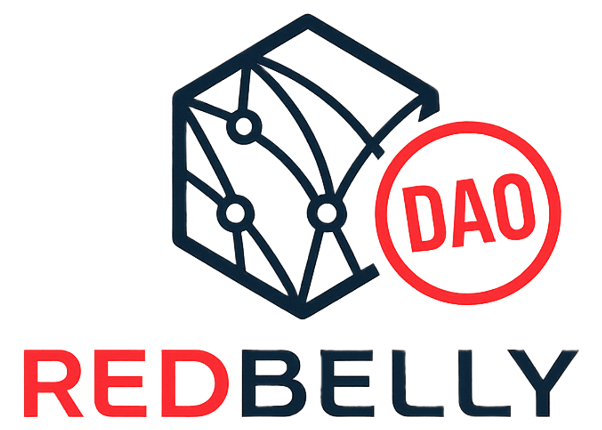
</picture>

# Redbelly Explained

**Eleven educational infographics that explain Redbelly's core ideas in plain language, one idea each.**

Made for the Redbelly DAO Start Here hub, the DAO website, Discord and X.

[**Live gallery**](https://redbelly-network-infographics.vercel.app/) ·
[**Download all 33 PNGs**](redbelly-explained/assets/redbelly-explained-png.zip) ·
[**Source list**](redbelly-explained/SOURCES.md) ·
[**Verification reports**](redbelly-explained/verification/)


<br>

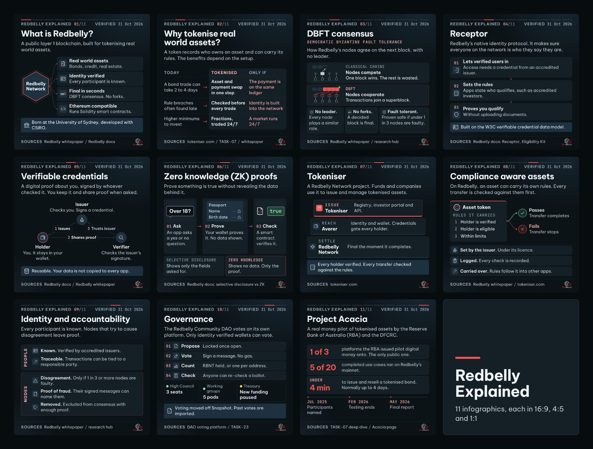

</div>

---

## Contents

- [The series](#the-series)
- [Formats](#formats)
- [Deliverables at a glance](#deliverables-at-a-glance)
- [Repository structure](#repository-structure)
- [Accuracy and sources](#accuracy-and-sources)
- [Verification](#verification)
- [Edit and rebuild](#edit-and-rebuild)
- [Design system](#design-system)
- [Licences](#licences)

## The series

Each infographic answers one question a newcomer asks, so they get it in under a minute. Click any image to open it full size, or use the links under it for each format.

<table>
  <tr>
    <td align="center" width="33%" valign="top">
      <a href="redbelly-explained/png/1x1/01-what-is-redbelly.png">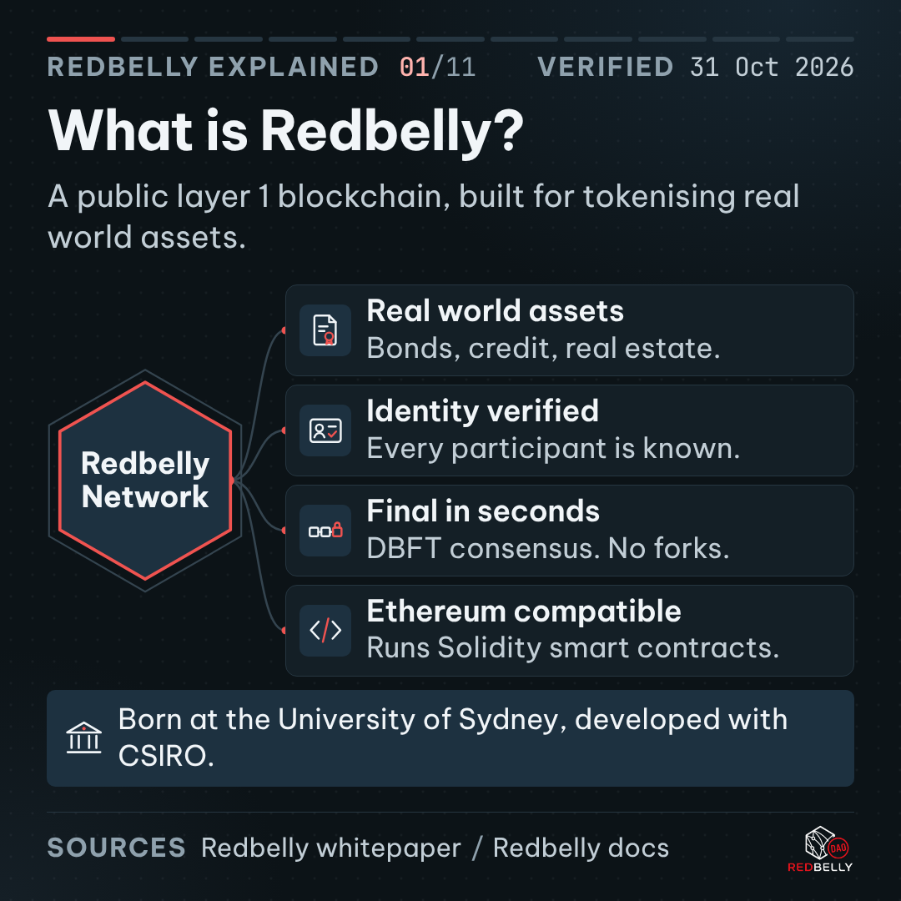</a><br>
      <sub><b>01 · What is Redbelly?</b></sub><br>
      <sub><a href="redbelly-explained/png/16x9/01-what-is-redbelly.png">16:9</a> · <a href="redbelly-explained/png/4x5/01-what-is-redbelly.png">4:5</a> · <a href="redbelly-explained/png/1x1/01-what-is-redbelly.png">1:1</a> · <a href="redbelly-explained/svg/16x9/01-what-is-redbelly.svg">SVG</a></sub>
    </td>
    <td align="center" width="33%" valign="top">
      <a href="redbelly-explained/png/1x1/02-why-tokenise-real-world-assets.png">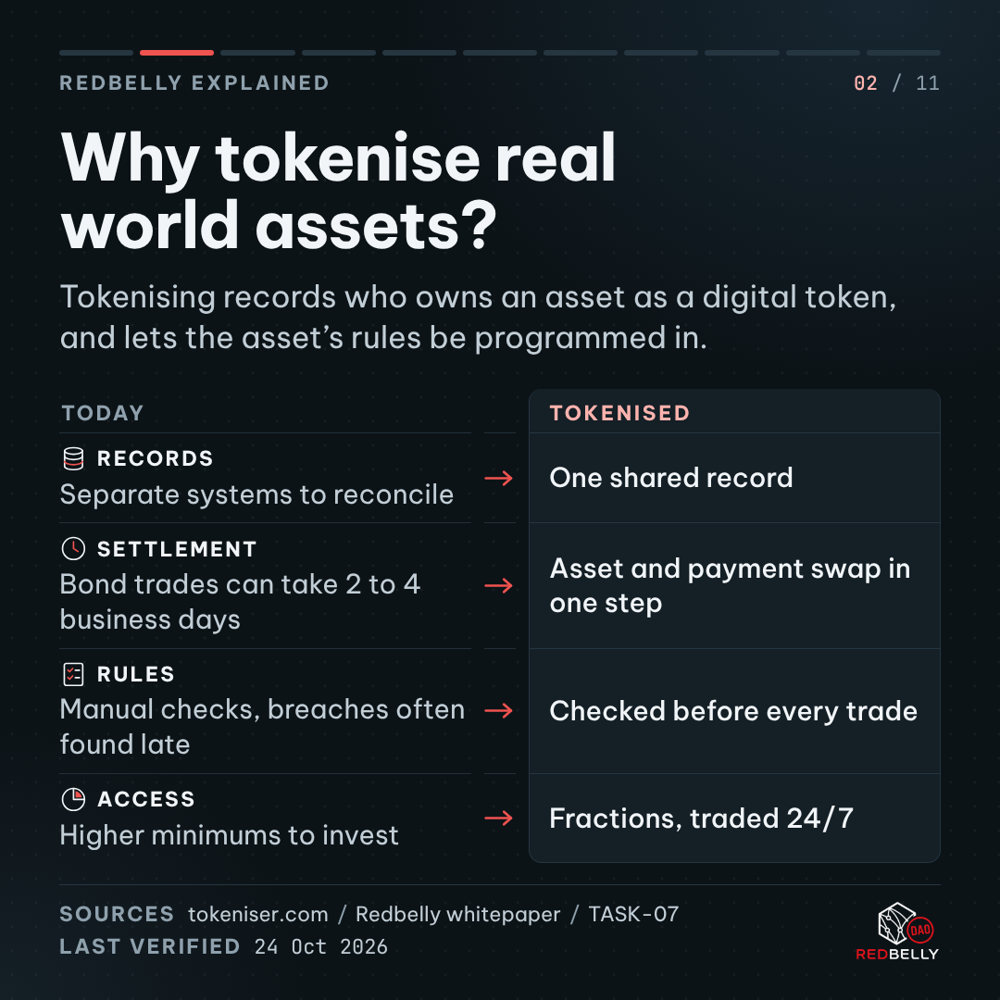</a><br>
      <sub><b>02 · Why tokenise real world assets?</b></sub><br>
      <sub><a href="redbelly-explained/png/16x9/02-why-tokenise-real-world-assets.png">16:9</a> · <a href="redbelly-explained/png/4x5/02-why-tokenise-real-world-assets.png">4:5</a> · <a href="redbelly-explained/png/1x1/02-why-tokenise-real-world-assets.png">1:1</a> · <a href="redbelly-explained/svg/16x9/02-why-tokenise-real-world-assets.svg">SVG</a></sub>
    </td>
    <td align="center" width="33%" valign="top">
      <a href="redbelly-explained/png/1x1/03-dbft-consensus.png">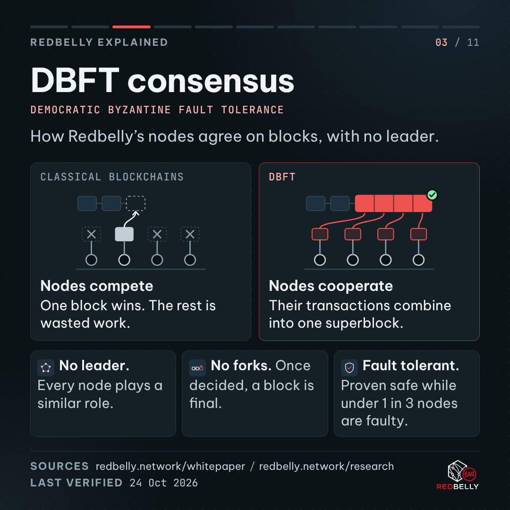</a><br>
      <sub><b>03 · DBFT consensus</b></sub><br>
      <sub><a href="redbelly-explained/png/16x9/03-dbft-consensus.png">16:9</a> · <a href="redbelly-explained/png/4x5/03-dbft-consensus.png">4:5</a> · <a href="redbelly-explained/png/1x1/03-dbft-consensus.png">1:1</a> · <a href="redbelly-explained/svg/16x9/03-dbft-consensus.svg">SVG</a></sub>
    </td>
  </tr>
  <tr>
    <td align="center" width="33%" valign="top">
      <a href="redbelly-explained/png/1x1/04-receptor.png">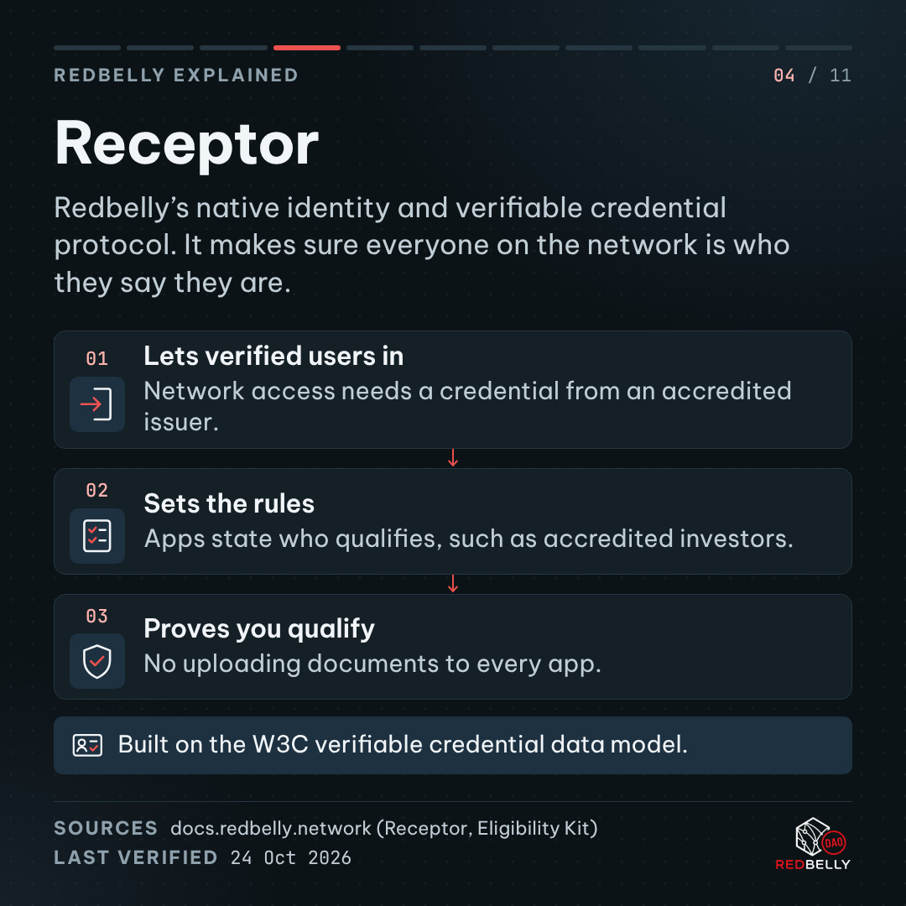</a><br>
      <sub><b>04 · Receptor</b></sub><br>
      <sub><a href="redbelly-explained/png/16x9/04-receptor.png">16:9</a> · <a href="redbelly-explained/png/4x5/04-receptor.png">4:5</a> · <a href="redbelly-explained/png/1x1/04-receptor.png">1:1</a> · <a href="redbelly-explained/svg/16x9/04-receptor.svg">SVG</a></sub>
    </td>
    <td align="center" width="33%" valign="top">
      <a href="redbelly-explained/png/1x1/05-verifiable-credentials.png">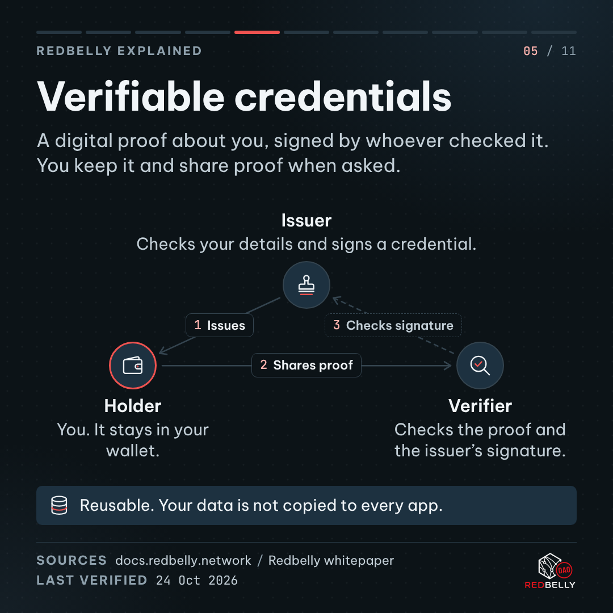</a><br>
      <sub><b>05 · Verifiable credentials</b></sub><br>
      <sub><a href="redbelly-explained/png/16x9/05-verifiable-credentials.png">16:9</a> · <a href="redbelly-explained/png/4x5/05-verifiable-credentials.png">4:5</a> · <a href="redbelly-explained/png/1x1/05-verifiable-credentials.png">1:1</a> · <a href="redbelly-explained/svg/16x9/05-verifiable-credentials.svg">SVG</a></sub>
    </td>
    <td align="center" width="33%" valign="top">
      <a href="redbelly-explained/png/1x1/06-zk-proofs.png">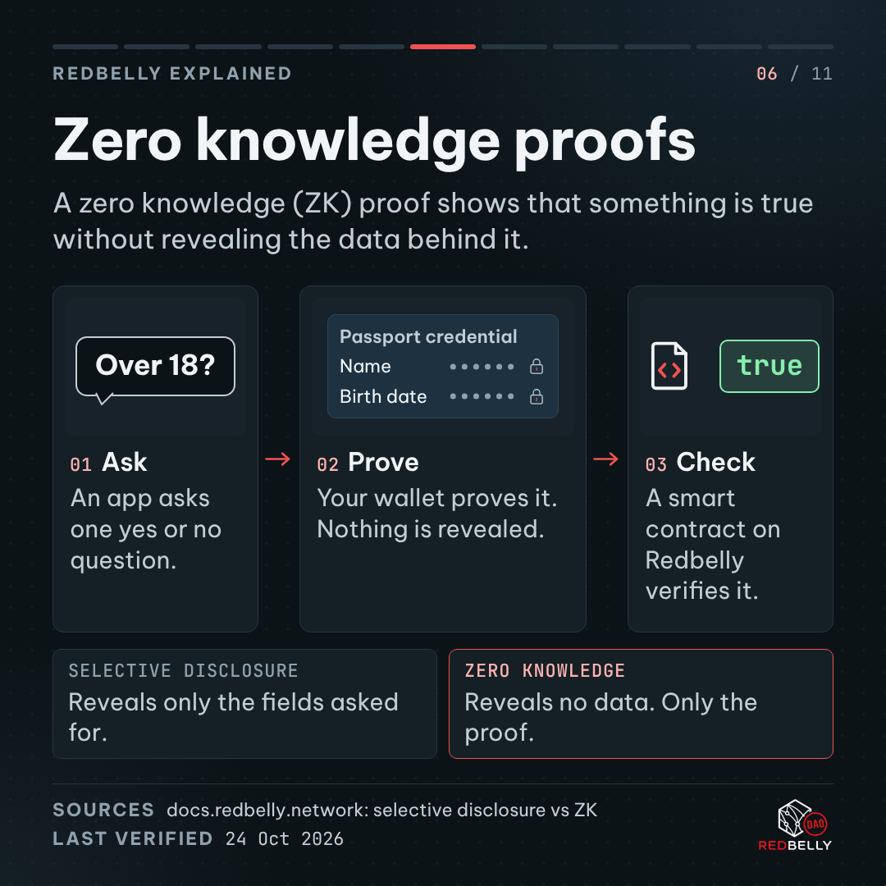</a><br>
      <sub><b>06 · Zero knowledge proofs</b></sub><br>
      <sub><a href="redbelly-explained/png/16x9/06-zk-proofs.png">16:9</a> · <a href="redbelly-explained/png/4x5/06-zk-proofs.png">4:5</a> · <a href="redbelly-explained/png/1x1/06-zk-proofs.png">1:1</a> · <a href="redbelly-explained/svg/16x9/06-zk-proofs.svg">SVG</a></sub>
    </td>
  </tr>
  <tr>
    <td align="center" width="33%" valign="top">
      <a href="redbelly-explained/png/1x1/07-tokeniser.png">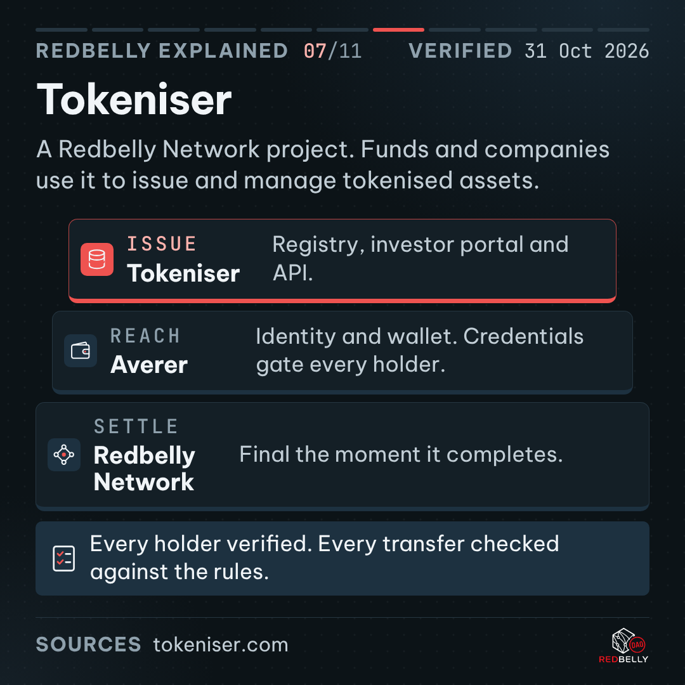</a><br>
      <sub><b>07 · Tokeniser</b></sub><br>
      <sub><a href="redbelly-explained/png/16x9/07-tokeniser.png">16:9</a> · <a href="redbelly-explained/png/4x5/07-tokeniser.png">4:5</a> · <a href="redbelly-explained/png/1x1/07-tokeniser.png">1:1</a> · <a href="redbelly-explained/svg/16x9/07-tokeniser.svg">SVG</a></sub>
    </td>
    <td align="center" width="33%" valign="top">
      <a href="redbelly-explained/png/1x1/08-compliance-aware-assets.png">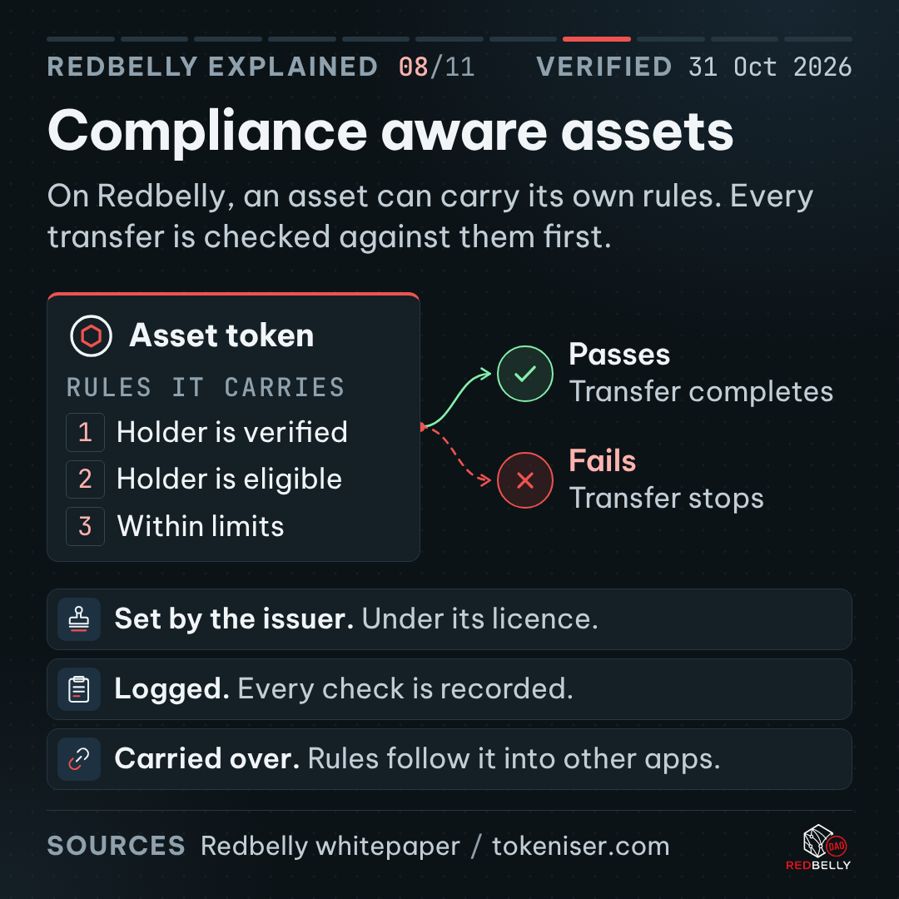</a><br>
      <sub><b>08 · Compliance aware assets</b></sub><br>
      <sub><a href="redbelly-explained/png/16x9/08-compliance-aware-assets.png">16:9</a> · <a href="redbelly-explained/png/4x5/08-compliance-aware-assets.png">4:5</a> · <a href="redbelly-explained/png/1x1/08-compliance-aware-assets.png">1:1</a> · <a href="redbelly-explained/svg/16x9/08-compliance-aware-assets.svg">SVG</a></sub>
    </td>
    <td align="center" width="33%" valign="top">
      <a href="redbelly-explained/png/1x1/09-identity-and-accountability.png">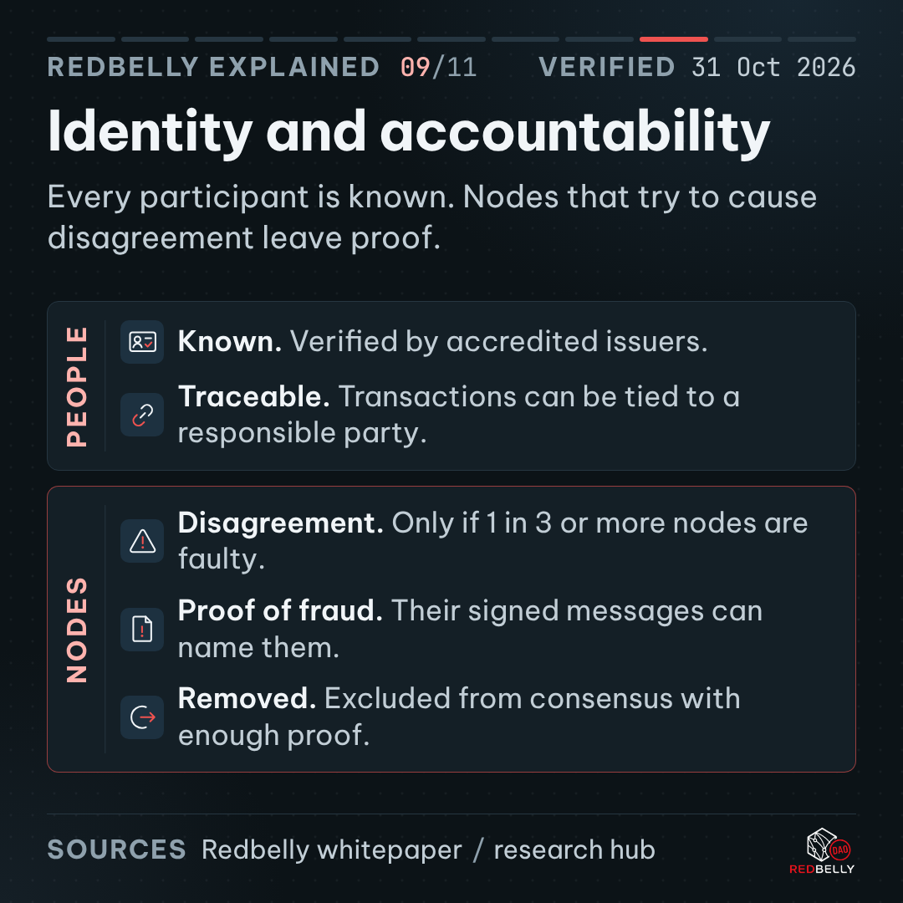</a><br>
      <sub><b>09 · Identity and accountability</b></sub><br>
      <sub><a href="redbelly-explained/png/16x9/09-identity-and-accountability.png">16:9</a> · <a href="redbelly-explained/png/4x5/09-identity-and-accountability.png">4:5</a> · <a href="redbelly-explained/png/1x1/09-identity-and-accountability.png">1:1</a> · <a href="redbelly-explained/svg/16x9/09-identity-and-accountability.svg">SVG</a></sub>
    </td>
  </tr>
  <tr>
    <td align="center" width="33%" valign="top">
      <a href="redbelly-explained/png/1x1/10-governance.png">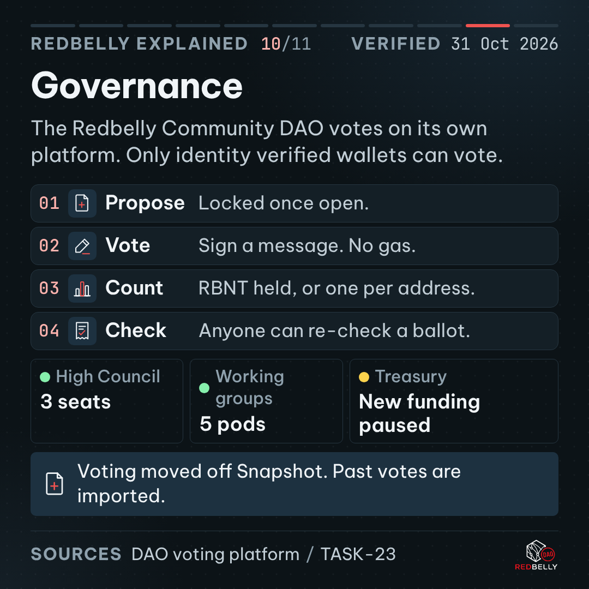</a><br>
      <sub><b>10 · Governance</b></sub><br>
      <sub><a href="redbelly-explained/png/16x9/10-governance.png">16:9</a> · <a href="redbelly-explained/png/4x5/10-governance.png">4:5</a> · <a href="redbelly-explained/png/1x1/10-governance.png">1:1</a> · <a href="redbelly-explained/svg/16x9/10-governance.svg">SVG</a></sub>
    </td>
    <td align="center" width="33%" valign="top">
      <a href="redbelly-explained/png/1x1/11-project-acacia.png">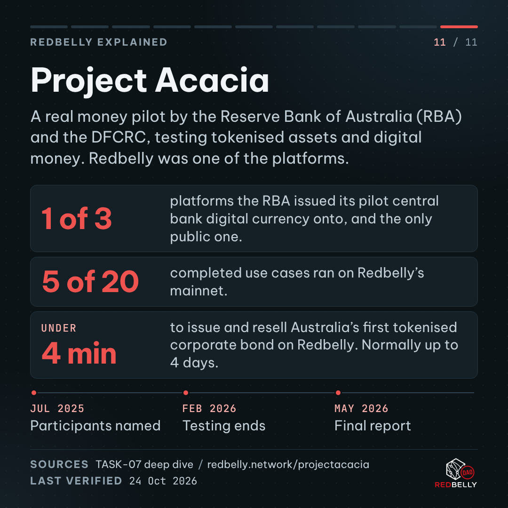</a><br>
      <sub><b>11 · Project Acacia</b></sub><br>
      <sub><a href="redbelly-explained/png/16x9/11-project-acacia.png">16:9</a> · <a href="redbelly-explained/png/4x5/11-project-acacia.png">4:5</a> · <a href="redbelly-explained/png/1x1/11-project-acacia.png">1:1</a> · <a href="redbelly-explained/svg/16x9/11-project-acacia.svg">SVG</a></sub>
    </td>
  </tr>
</table>

| No. | Topic | The one idea |
| :-: | --- | --- |
| 01 | What is Redbelly? | A public layer 1 blockchain built for tokenising real world assets. |
| 02 | Why tokenise real world assets? | A token records who owns an asset and carries its rules. Today versus tokenised. |
| 03 | DBFT consensus | Nodes agree on blocks together, with no leader, so blocks are final. |
| 04 | Receptor | Redbelly's identity protocol: lets verified users in, sets rules, proves you qualify. |
| 05 | Verifiable credentials | Issuer, holder and verifier: a signed proof you keep and share. |
| 06 | Zero knowledge proofs | Prove something is true without revealing the data. |
| 07 | Tokeniser | The Redbelly Network project funds and companies use to issue and manage tokenised assets. |
| 08 | Compliance aware assets | An asset carries its own rules and every transfer is checked against them. |
| 09 | Identity and accountability | Every participant is known, and a node that cheats leaves proof. |
| 10 | Governance | How the Redbelly Community DAO decides today, on its own voting platform. |
| 11 | Project Acacia | The RBA and DFCRC real money pilot, and Redbelly's part in it. |

## Formats

Every infographic is delivered in all three formats, as PNG and as editable SVG with live text.

| Format | Size | Best for | PNG | SVG |
| --- | --- | --- | --- | --- |
| 16:9 landscape | 1920 × 1080 | Website, X cards, slides | [`png/16x9`](redbelly-explained/png/16x9) | [`svg/16x9`](redbelly-explained/svg/16x9) |
| 4:5 portrait | 1080 × 1350 | Phone feeds | [`png/4x5`](redbelly-explained/png/4x5) | [`svg/4x5`](redbelly-explained/svg/4x5) |
| 1:1 square | 1080 × 1080 | Discord, pins, X | [`png/1x1`](redbelly-explained/png/1x1) | [`svg/1x1`](redbelly-explained/svg/1x1) |

Each file name (for example `10-governance`) exists in all three PNG folders and all three SVG folders.

## Deliverables at a glance

| Required deliverable | Where to find it |
| --- | --- |
| 11 infographics × 3 formats (33 images) | [`png/`](redbelly-explained/png) · [zip of all 33](redbelly-explained/assets/redbelly-explained-png.zip) |
| Editable source files | [`svg/`](redbelly-explained/svg) (open in Figma, Illustrator or Inkscape) and [`source/`](redbelly-explained/source) (HTML, CSS and build scripts) |
| Source list for every infographic | [`SOURCES.md`](redbelly-explained/SOURCES.md) · [live version](https://redbelly-network-infographics.vercel.app/sources.html) |

## Repository structure

```text
redbelly-explained/
├── png/                  33 finished PNGs: 16x9/, 4x5/, 1x1/
├── svg/                  The same 33 designs as editable SVG with live text
├── source/
│   ├── src/              Content (topics.js), styles, icons and the renderer
│   ├── tools/            Render, export, check, verify and site build scripts
│   ├── brand/            Redbelly DAO logo from the Task Board brand kit
│   └── fonts/            Be Vietnam Pro and JetBrains Mono, with OFL licences
├── verification/         Check reports as Markdown, HTML and JSON
├── assets/               overview.png and the zip of all 33 PNGs
├── SOURCES.md            Every fact, its page and a supporting quote
├── sources.html          The same source list as a web page
└── index.html            The live gallery
```

## Accuracy and sources

- **Supplied resources only.** Every fact on the artwork maps to a page from the task's resource list and a supporting quote in [`SOURCES.md`](redbelly-explained/SOURCES.md).
- **Current governance.** Infographic 10 follows the TASK-23 changelog for what has been decided and is in force, and the DAO voting platform for how voting works today. Where the changelog describes Snapshot voting, the voting platform takes priority. Constitution v1.2 and Snapshot rules are not used.
- **Nothing that goes stale or misleads.** Figures that change daily (node counts, TVL, transaction totals) are left out, along with all price talk, investment wording and promises of returns.
- **Dated.** Every infographic prints a "last verified" date, so readers know when the facts were checked.

## Verification

Every check runs from a script in `source/tools/` and writes a report to [`verification/`](redbelly-explained/verification/).

| Check | Command | Result (24 Oct 2026) |
| --- | --- | --- |
| Every quote in the source list is still on its live page | `npm run verify` | ✅ 96 of 96 quotes found on 28 pages |
| Every PNG at the required size; no clipped, overlapping or out-of-bounds text; smallest text measured at phone width | `npm run check` | ✅ 33 of 33 layouts pass |
| Every SVG redrawn and compared pixel by pixel with its PNG | `npm run compare` | ✅ 33 of 33 match |
| No price talk, investment wording, personal credit, emoji or outdated governance wording | `npm run lint` | ✅ Pass |

Full reports: [source check](redbelly-explained/verification/source-check.md) · [layout check](redbelly-explained/verification/layout-check.md) · [SVG check](redbelly-explained/verification/svg-check.md)

## Edit and rebuild

All words come from one content file, so the PNGs, SVGs, gallery and source list never drift apart.

| To change | Edit |
| --- | --- |
| Titles, text, labels and the facts behind them | `source/src/topics.js` |
| The "last verified" date | `RX.verified` in `source/src/topics.js` |
| Colours and fonts | `source/src/tokens.css` |
| Diagram layout, per format | `source/src/series.css` |
| Icons (drawn for this series on a 48 unit grid) | `source/src/icons.js` |

```bash
cd redbelly-explained/source
npm install
npx playwright install chromium
npm run build     # PNGs, SVGs, layout check, SVG check, copy check, gallery and source list
npm run verify    # re-reads every cited page and confirms each quote (needs internet and pdftotext)
```

To edit in a design tool, drag any file from `svg/` into Figma: the text stays editable. For Illustrator or Inkscape, install Be Vietnam Pro and JetBrains Mono from Google Fonts first.

## Design system

- **One series look.** Every infographic shares the same frame: an 11-step series rail with the current topic in red, a title and a one-sentence answer, one diagram, and a footer with sources, the last verified date and the DAO logo.
- **Brand.** The series follows the Redbelly DAO Task Board brand kit: deep slate surfaces, one red accent (`#EF5350`), Be Vietnam Pro for words and JetBrains Mono for machine values. The kit asks that DAO material is not presented under the Redbelly Network name, so the DAO mark is used and the Redbelly Network logo is not.
- **Phone first.** Type sizes are set per format and measured on a 390 pt wide phone screen. On the 4:5 and 1:1 files the smallest body text is about 10 pt or more.

## Licences

| Asset | Licence |
| --- | --- |
| Be Vietnam Pro, JetBrains Mono | SIL Open Font License 1.1 (licence texts in `source/fonts/`) |
| Redbelly DAO logo | From the [Task Board brand kit](https://taskboard.redbellydao.network/brand), dark and light versions, used as supplied |
| Icons, diagrams, layouts and code | Original work made for this series |
| Playwright (build only) | Apache 2.0, not shipped with the site |

No stock images, icon sets, templates or third-party artwork are included.
